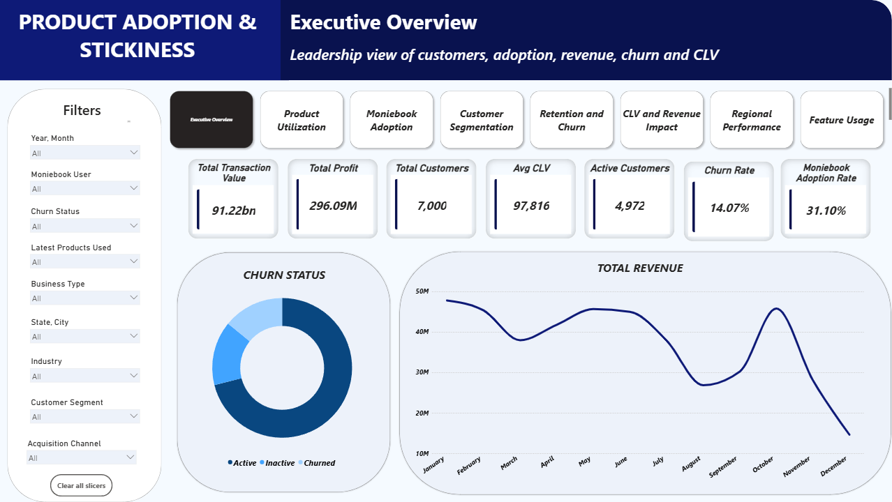

# 📊 Fintech Product Adoption & Customer Lifetime Value Analytics

An end-to-end fintech business intelligence project analyzing **multi-product adoption, merchant engagement, operational friction, customer lifetime value (CLV), and churn risk** across **7,000 merchants and 1.18M sessions** covering 2024–2025.

The project combines **SQL, MySQL, DAX, and Power BI** to transform raw relational data into a merchant 360° analytical framework for understanding customer behavior, profitability, adoption, and retention.

---

## 📌 Core Analytical Highlights

* **₦296M Cumulative Profit:** The simulated merchant base generated approximately **₦296M in cumulative profit** across the analysis period.

* **₦661M Total CLV:** Estimated customer lifetime value across the simulated merchant base reached approximately **₦661M**.

* **4-Product Profitability Sweet Spot:** Merchants using **4 integrated products** represented the highest cumulative profitability segment, generating more than **₦100M in simulated profit**.

* **220-Day Moniebook Adoption Gap:** Merchants took an average of approximately **220 days (~7.3 months)** before first adopting Moniebook.

* **53,531 POS Failures:** POS recorded approximately **53,531 failed transactions**, making it the largest source of simulated transaction failures.

* **₦72B+ Transaction Volume:** Medium and Enterprise merchants represented less than 20% of the simulated merchant population but generated more than **₦72B in gross transaction volume**.

* **7–8 Product Retention Pattern:** Merchants using 7–8 products recorded **100% retention in the simulated dataset**, compared with 64–68% among merchants using 0–2 products.

* **81% Micro-Merchant Concentration:** Micro-merchants represented approximately **81% of the simulated merchant population**, highlighting a large customer segment with comparatively lower transaction concentration.

---

# 📌 Executive Summary



Fintech platforms generate large volumes of transaction and behavioral data, but transaction volume alone does not explain why merchants remain engaged, become inactive, or generate long-term customer value.

This project examines the relationship between:

* Product adoption depth
* Merchant engagement
* Transaction activity
* Operational failures
* Customer profitability
* Customer lifetime value
* Churn and retention patterns

The objective was to build a **Merchant 360° analytics framework** that enables business teams to identify high-value customers, understand product adoption behavior, detect potential churn signals, and identify opportunities for cross-selling and retention.

> **Important:** This is a portfolio project using synthetic data. The findings demonstrate analytical techniques and simulated business patterns rather than real-world company performance.

---

# 📊 Data Source

### Synthetic / AI-Generated Data

The dataset used in this project is **synthetic data generated with the assistance of AI** for educational and portfolio purposes.

It does **not** represent real customer, merchant, transaction, financial, or company records.

The dataset was designed to simulate realistic fintech business scenarios and support analysis of:

* Customer behavior
* Product adoption
* Transaction activity
* Feature usage
* Customer profitability
* Churn and retention
* Operational failures
* Cohort adoption patterns

All merchant names, customer records, transaction values, product information, behavioral metrics, and other data points are fictional.

---

# 🎯 Business Questions

The analysis was designed around the following questions:

1. How does the number of products adopted relate to merchant retention and profitability?
2. Which products and features have the highest usage and adoption?
3. How long does it take merchants to adopt Moniebook?
4. Which customer segments contribute the most transaction volume and CLV?
5. Which products generate the highest operational failure rates?
6. Which merchants exhibit potential churn risk?
7. Which acquisition channels generate the strongest merchant adoption?
8. Where are high-value and high-churn merchants geographically concentrated?
9. Which customer segments represent the strongest cross-selling opportunities?

---

# 🧱 Architecture & Data Engineering Workflow

```text
┌───────────────────────────────────────────────┐
│           RAW RELATIONAL DATASETS             │
│                                               │
│ Customers · Products · Features               │
│ Transactions · Activity                       │
└───────────────────────┬───────────────────────┘
                        │
                        ▼
┌───────────────────────────────────────────────┐
│           SQL TRANSFORMATION LAYER            │
│                                               │
│ Cleaning · Joins · Aggregations               │
│ Feature Engineering · Analytical Marts        │
└───────────────────────┬───────────────────────┘
                        │
                        ▼
┌───────────────────────────────────────────────┐
│          POWER BI ANALYTICAL MODEL            │
│                                               │
│ Relationships · Dimension Lookups             │
│ DAX Measures · Calculated Flags               │
└───────────────────────┬───────────────────────┘
                        │
                        ▼
┌───────────────────────────────────────────────┐
│             MERCHANT 360° ANALYTICS           │
│                                               │
│ CLV · Profit · Adoption · Engagement          │
│ Churn Risk · Product Usage · Geography        │
└───────────────────────────────────────────────┘
```

---

# 🗄️ Data Modeling & SQL Analytical Marts

SQL was used to transform the raw relational datasets into three analytical tables designed specifically for Power BI reporting.

The tables were created at different analytical grains to support **merchant-level analysis, product performance analysis, and monthly Moniebook adoption tracking**.

| Analytical Table                 | Grain                | Purpose                                                                              |
| -------------------------------- | -------------------- | ------------------------------------------------------------------------------------ |
| `pbi_customer_360`               | One row per merchant | Customer-level CLV, profit, segment, engagement, activity and churn analysis         |
| `pbi_monthly_moniebook_adoption` | One row per month    | Monthly Moniebook adoption, new adopters, cumulative adoption and penetration trends |
| `pbi_product_performance`        | One row per product  | Product users, sessions, adoption, transaction activity and failure performance      |

### SQL Transformation Workflow

```text
Raw Relational Data
        │
        ▼
   SQL Queries
        │
        ├── Customer-level aggregation
        │       ↓
        │   pbi_customer_360
        │
        ├── Monthly adoption aggregation
        │       ↓
        │   pbi_monthly_moniebook_adoption
        │
        └── Product-level aggregation
                ↓
          pbi_product_performance
                │
                ▼
             Power BI
```

This approach separated the raw transactional data from the reporting layer and provided Power BI with purpose-built analytical tables for dashboard development.

---

# 🔍 Analytical Framework

The project focuses on five major analytical dimensions.

### 1. Product Adoption

Measures the number and combination of products adopted by each merchant and examines how adoption depth varies across customer segments.

### 2. Merchant Engagement

Analyzes sessions, login cadence, feature usage, and activity decay to identify changes in merchant engagement.

### 3. Customer Lifetime Value

Uses profitability and customer activity metrics to estimate the relative economic value of individual merchants.

### 4. Churn & Retention

Uses inactivity and engagement indicators to identify merchants displaying potential churn-risk patterns.

### 5. Operational Friction

Analyzes transaction failures and product-level issues to identify potential sources of merchant friction.

---

# 📈 Power BI Dashboard #

[Download Power BI Report](Fintech%20Data%20Power%20BI.pbix)

The Power BI report is structured across **8 analytical and operational canvases**.

### 01 — Executive Overview [Executive Overview](01_Executive_Overview.png)

Provides a high-level view of platform performance, including:

* Merchant count
* Sessions
* Cumulative profit
* Total CLV
* Product adoption
* Retention indicators

### 02 — Product Utilization [Product Utilization](02_Product_Utilization.png)

Analyzes adoption and engagement across the 8 simulated product offerings:

* Payments 
* POS 
* Banking 
* Moniebook
* Loans
* Cards
* Invoicing
* Payroll

### 03 — Moniebook Adoption [Moniebook Adoption](03_Moniebook_Adoption.png)

The primary product-adoption analysis examining:

* Time-to-adoption
* Monthly adoption trends
* Sector penetration
* Cumulative adoption
* Adoption gaps

### 04 — Customer Segmentation [Customer Segmentation](04_Customer_Segmentation.png)

Compares merchant segments based on:

* Merchant population
* Transaction volume
* CLV
* Profitability
* Churn

### 05 — Retention & Churn [Retention & Churn](05_Retention_and_Churn.png)

Analyzes:

* Product depth vs. retention
* Inactivity
* Login cadence
* Churn-risk indicators
* Engagement decay

### 06 — CLV & Revenue Impact [CLV & Revenue](06_CLV_and_Revenue_Impact.png)

Examines:

* Profit distribution
* CLV by segment
* Product depth
* High-value merchants
* Profitability patterns

### 07 — Regional Performance [Regional Performance](07_Regional_Performance.png)

Analyzes geographic variation in:

* Merchant concentration
* Churn
* Product adoption
* Moniebook penetration

### 08 — Feature Usage & Stickiness [Feature Usage & Stickiness](08_Feature_Usage.png)

Analyzes feature-level adoption and merchant engagement across the product portfolio, with a focus on:

- Feature adoption rates
- Unique users by product
- Usage events
- Session depth
- Product-level performance
- Failed transactions and operational friction
- Usage concentration across product categories
- Signals of deeper product engagement and stickiness

The page combines product-level KPIs, usage trends, adoption metrics, and operational performance to identify which products and features generate deeper merchant engagement.

### 09 — Customer 360° Drillthrough [Customer 360](10_Customer_360_Drilltrough.png)

Provides a detailed merchant-level diagnostic view containing:

* Merchant profile
* Product adoption checklist
* CLV
* Profit
* Activity status
* Inactivity indicators
* POS failure history
* Churn-risk signals

---

# 💡 Key Business Insights

> **Note:** The findings below represent patterns observed within the synthetic dataset and should not be interpreted as real-world fintech performance metrics.

### 1. Product Depth & Profitability

Merchant profitability was highest among merchants using **4 products**, with the simulated dataset showing more than **₦100M in cumulative profit** within this group.

### 2. Product Adoption & Retention

Merchants using fewer products showed lower simulated retention levels, while merchants using a broader product portfolio exhibited higher retention.

The dataset showed approximately:

* **0–2 products:** 64–68% retention
* **3–6 products:** ~79% retention
* **7–8 products:** 100% retention

This represents an observed association within the synthetic dataset and does not establish that product adoption causes higher retention.

### 3. Moniebook Adoption Gap

Merchants took an average of approximately **220 days (~7.3 months)** before first adopting Moniebook.

This suggests a significant simulated gap between initial platform engagement and bookkeeping adoption.

### 4. POS Operational Friction

POS transactions generated approximately **53,531 failed transactions**, making POS the largest source of simulated transaction failures in the dataset.

### 5. Volume vs. Customer Concentration

Micro-merchants represented approximately **81% of the simulated merchant population**, while Medium and Enterprise merchants generated more than **₦72B in gross transaction volume**.

### 6. Acquisition Channel Differences

The simulated dataset showed higher merchant conversion through:

* **Field Sales — 34.5%**
* **Partner Banks — 34.0%**
* **Social Media — 27.0%**
* **Trade Fairs — 23.0%**

These figures describe the simulated dataset and are not representative of actual industry conversion rates.

---

# 🎯 Strategic Recommendations

Based on the patterns observed in the simulated data, the analysis suggests several potential business actions.

### 1. Reduce the Moniebook Adoption Gap

Introduce onboarding prompts and guided bookkeeping setup during the first 30 days to reduce the observed 220-day adoption lag.

### 2. Develop a Simplified Bookkeeping Experience

A lightweight bookkeeping workflow could potentially make adoption easier for smaller merchants with lower operational complexity.

### 3. Create Automated Churn Alerts

Use inactivity and transaction-decline signals to trigger customer-success interventions before merchants become fully inactive.

### 4. Encourage Multi-Product Adoption

Use targeted cross-selling journeys to introduce complementary products based on each merchant's existing product usage.

### 5. Prioritize Operational Failure Resolution

Investigate the causes of repeated POS failures and prioritize merchants experiencing persistent transaction issues.

### 6. Segment Customer Success Efforts

Use CLV, transaction volume, and churn-risk indicators to prioritize retention resources toward higher-value or strategically important merchants.

---

# ⚠️ Analytical Limitations

### Synthetic Dataset

The dataset is synthetic and AI-assisted. Results cannot be used to make claims about actual fintech customers, companies, market performance, or industry behavior.

### No Causal Inference

Observed relationships between product adoption, retention, and profitability represent patterns within the simulated dataset. They do not establish causation.

### POS Failure Attribution

The dataset captures failure occurrences but does not contain detailed hardware, telecommunications, or bank error codes required to determine the precise cause of each failure.

### Churn Classification

Churn is inferred primarily from inactivity and engagement signals. The model does not distinguish between competitive churn, business closure, seasonal inactivity, or other causes.

### Simulated Financial Metrics

Profit, CLV, and transaction values are modeled for analytical purposes and should not be interpreted as actual financial performance.

---

# 🛠️ Tech Stack

### Database & Data Transformation

* **MySQL** — Relational data storage, joins, transformations, and analytical marts
* **SQL** — Data cleaning, aggregation, feature engineering, and customer-level analysis
* **Excel** — Data inspection, validation, and preliminary analysis

### Business Intelligence

* **Power BI** — Data modeling, interactive dashboards, drillthrough, visualization, and reporting
* **DAX** — CLV calculations, inactivity analysis, churn-risk flags, segmentation, and dynamic measures

### Analytical Techniques

* Customer 360° analysis
* Customer Lifetime Value (CLV)
* Product adoption analysis
* Cohort analysis
* Customer segmentation
* Retention and churn analysis
* Activity decay analysis
* Operational failure analysis
* Geographic analysis
* Cross-product adoption analysis

---

# 📂 Project Structure

```text
fintech-product-adoption-clv/
│
├── data/
│   ├── pbi_customer_360.csv
│   ├── pbi_monthly_moniebook_adoption.csv
│   └── pbi_product_performance.csv
│
├── sql/
│   ├── Fintech_data.sql
│
├── powerbi/
│   └── Fintech_Data_Power BI.pbix
│
├── screenshots/
│   ├── executive_overview.png
│   ├── product_utilization.png
│   ├── moniebook_adoption.png
│   ├── customer_segmentation.png
│   ├── retention_and_churn.png
│   ├── clv_and_revenue_impact.png
│   ├── regional_performance.png
|   ├── feature_usage.png
|   ├── tooltip.png
│   └── customer_360_drilltrough.png
│
└── README.md
```

---

# 🚀 Project Objective

The goal of this project was to demonstrate how a data analyst can move from:

**Raw Data → SQL Transformation → Analytical Data Modeling → Business Metrics → DAX → Interactive BI Reporting → Business Insights**

Rather than focusing only on transaction volume, the project evaluates the relationship between **product adoption, merchant engagement, operational friction, customer value, and retention** to create a more complete view of merchant behavior.

---

## 📌 Key Skills Demonstrated

**SQL • MySQL • Power BI • DAX • Data Modeling • Customer Analytics • CLV • Churn Analysis • Cohort Analysis • Segmentation • Business Intelligence • Data Storytelling**
